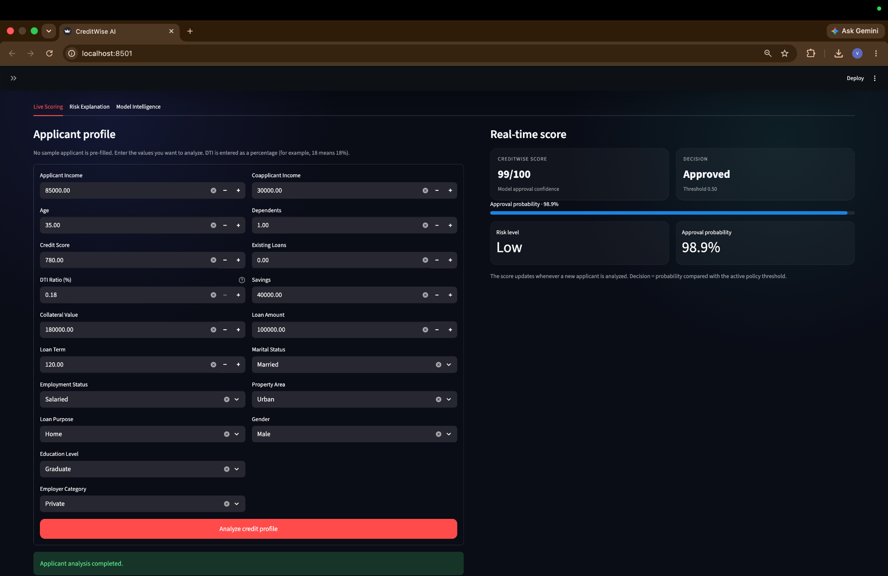
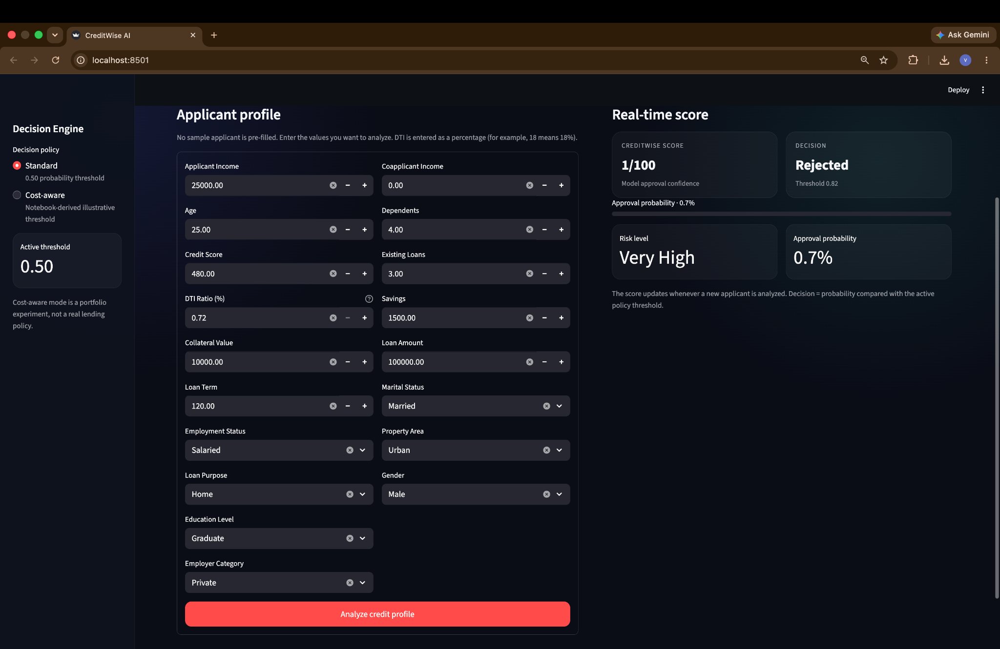
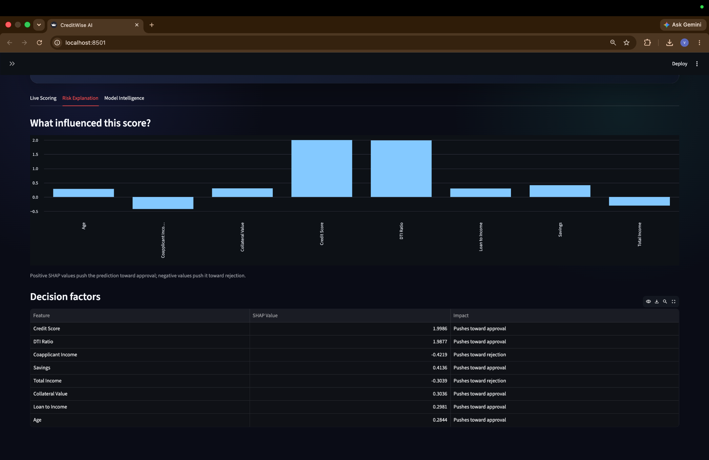

# CreditWise AI

**Explainable Loan Approval & Credit Risk Prediction**

CreditWise AI is an end-to-end Data Science portfolio project that predicts loan-approval probability and explains the factors influencing each prediction. It combines leakage-safe preprocessing, feature engineering, model comparison, XGBoost, SHAP explainability, threshold analysis, and a Streamlit inference application.

> **Educational project only.** CreditWise is not intended or validated for real credit underwriting or financial decision-making.

## Demo

### Low-risk / Approved applicant



### High-risk / Rejected applicant



### Applicant-level SHAP explanation



## What the system does

An applicant profile is passed through the same preprocessing and feature-engineering workflow used during training. The trained XGBoost pipeline produces an approval probability, which is converted into an approval/rejection decision using the selected probability threshold.

The application provides:

- real-time approval probability
- CreditWise score from 0–100
- Approved / Rejected decision
- risk-level indicator
- SHAP-based applicant explanations
- standard and experimental cost-aware thresholds
- model-performance information

## Architecture

```text
Applicant Data
      │
      ▼
Feature Engineering
      │
      ▼
Leakage-Safe Preprocessing
 ┌───────────────┬──────────────────┐
 │ Numeric       │ Categorical      │
 │ Imputation    │ Imputation       │
 │ Scaling       │ One-Hot Encoding │
 └───────────────┴──────────────────┘
      │
      ▼
   XGBoost
      │
      ├──────────────► SHAP Explanation
      │
      ▼
Approval Probability
      │
      ▼
Decision Threshold
      │
      ▼
Approved / Rejected + Risk Level
```

## Data Science workflow

### 1. Data quality and leakage controls

Identifier-like fields such as `Applicant_ID` are excluded from modeling. Preprocessing is encapsulated inside scikit-learn pipelines so imputation, scaling, and encoding are learned only from training data within each split or cross-validation fold.

### 2. Feature engineering

CreditWise derives financial features including:

- total income
- applicant-income log transform
- loan-to-income ratio
- savings-to-loan ratio
- collateral coverage
- income per dependent

Ratio calculations protect against invalid denominators and non-finite values.

### 3. Model comparison

Three classifiers are evaluated under the same stratified cross-validation framework:

- Logistic Regression
- Random Forest
- XGBoost

XGBoost provided the strongest overall predictive performance.

### 4. Hyperparameter tuning

`RandomizedSearchCV` explores XGBoost learning rate, tree depth, estimator count, sampling parameters, and regularization using training-only cross-validation.

An important result of the experiment was that tuning did **not** materially improve held-out performance. The project therefore treats tuning as an experiment to evaluate rather than assuming that a tuned model must generalize better.

### 5. Explainability

SHAP is used to explain individual XGBoost predictions.

Positive SHAP values push a prediction toward approval, while negative values push it toward rejection. This makes the application capable of answering not only *what* it predicted, but also *which model features influenced that prediction*.

### 6. Decision-threshold analysis

The classifier produces a probability rather than an inherent approval/rejection decision. CreditWise therefore evaluates probability thresholds using out-of-fold training predictions.

The project also demonstrates cost-sensitive threshold selection using illustrative assumptions:

- false approval cost: **$5,000**
- false rejection cost: **$1,000**

These values are analytical assumptions used to demonstrate business-aware model evaluation; they are not real lender economics.

## Results

The stronger baseline XGBoost configuration achieved approximately:

| Metric | Held-out Test |
|---|---:|
| Accuracy | **95.79%** |
| F1 Score | **93.65%** |
| ROC-AUC | **98.31%** |

The saved tuned artifact reports approximately **0.991 training cross-validation ROC-AUC** and **0.981 held-out ROC-AUC**.

The distinction is intentional: tuning was evaluated rather than presented as an automatic improvement.

## Technology

**Data Science:** Python, pandas, NumPy, scikit-learn, XGBoost  
**Explainability:** SHAP  
**Visualization:** Matplotlib, Streamlit charts  
**Application:** Streamlit  
**Model persistence:** joblib

## Project structure

```text
creditwise/
├── app.py
├── src/
│   ├── __init__.py
│   ├── features.py
│   ├── predict.py
│   └── explain.py
├── artifacts/
│   ├── creditwise_xgboost_pipeline.joblib
│   └── creditwise_metadata.json
├── notebooks/
│   └── creditwise_v4.ipynb
├── assets/
│   ├── approved-applicant.png
│   ├── rejected-applicant.png
│   └── shap-explanation.png
├── requirements.txt
├── .gitignore
└── README.md
```

## Run locally

```bash
git clone <YOUR-REPOSITORY-URL>
cd creditwise

python3 -m venv .venv
source .venv/bin/activate

pip install -r requirements.txt
streamlit run app.py
```

On Windows:

```bash
.venv\Scripts\activate
streamlit run app.py
```

## Notebook

The notebook documents the complete modeling workflow:

```text
Dataset
  ↓
Data Quality & Leakage Controls
  ↓
EDA
  ↓
Feature Engineering
  ↓
Train/Test Split
  ↓
Leakage-Safe Preprocessing
  ↓
Model Comparison
  ↓
XGBoost Evaluation
  ↓
Hyperparameter Tuning
  ↓
SHAP Explainability
  ↓
Threshold Analysis
  ↓
Business-Cost Experiment
  ↓
Model Artifact
```

## Key learning outcomes

This project demonstrates more than fitting a classifier. It focuses on reproducible preprocessing, leakage prevention, cross-validation, model selection, explainability, threshold-dependent decisions, business-aware evaluation, and serving a trained pipeline through an interactive application.

## Limitations

- The project uses a portfolio/educational dataset rather than production lending data.
- Approval probabilities should not be interpreted as calibrated real-world default probabilities.
- The cost-sensitive threshold uses illustrative assumptions.
- Fairness, regulatory compliance, drift monitoring, and production model governance would require substantially more work before any real financial use.

## Author

**Vinayak Bhat**  
Artificial Intelligence & Machine Learning
